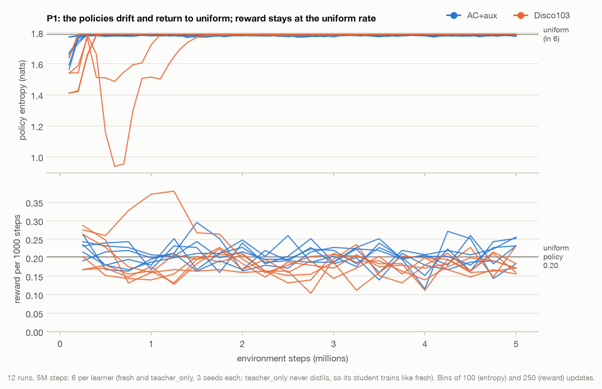
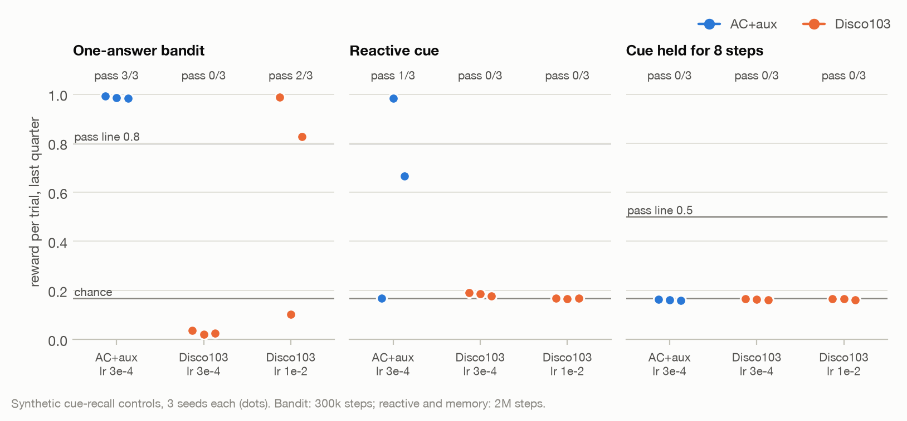
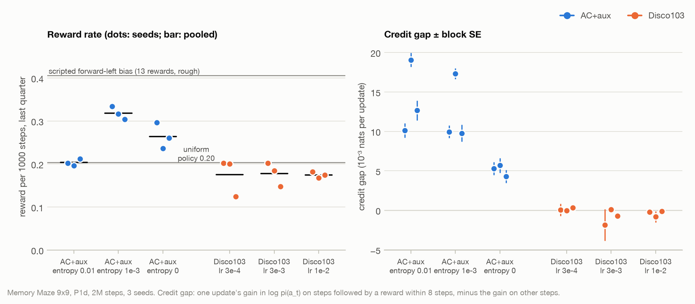
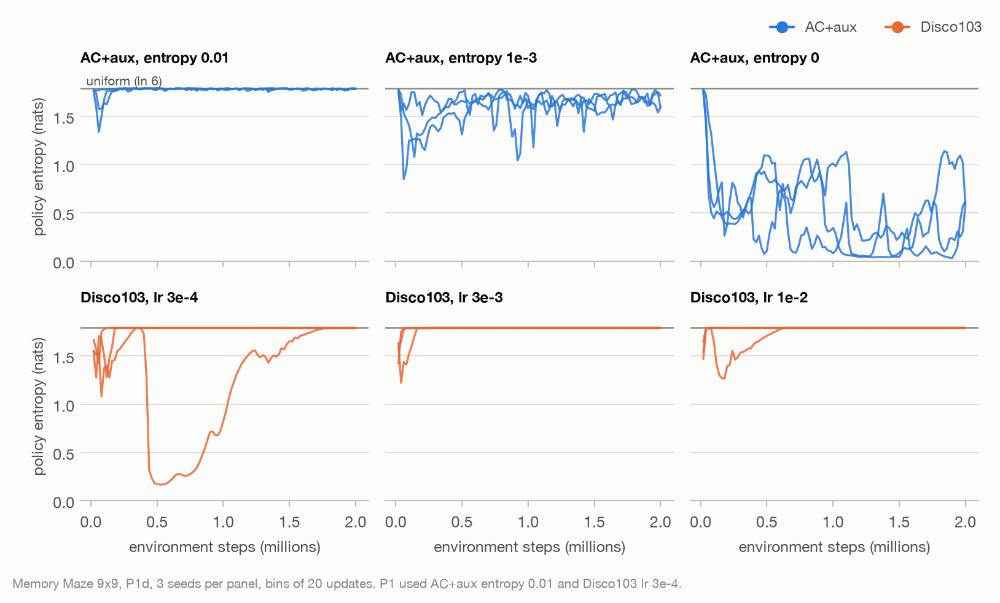

# DiscoSpatial

[English](README.md) | **한국어**

**DeepMind가 공개한 meta-learned RL 규칙(Disco103)으로 recurrent 픽셀 agent를 Memory Maze에서 학습시키면 공간 능력이 생기는가? SDPO형 사후 피드백은 도움이 되는가?** 이 프로젝트는 첫 학습 관문에서 멈췄습니다. 두 학습기 모두 균일 무작위 정책을 넘지 못했습니다. 이어진 진단 단계에서 실패 원인을 서로 다른 두 가지로 좁혔습니다. 이 문서는 그 단계(`P1d`)까지의 보고서입니다. 여기 있는 내용은 모두 pilot·진단 증거이며 연구 결과가 아닙니다.

> **상태 (2026-10-31):** 예산 문제로 P1d 이후 중단했습니다. Vast.ai L40S 한 대에서 GPU run 57개(P1 12개, P1d 45개)를 돌렸습니다. 수치: [`reports/results/summary.json`](reports/results/summary.json) · 단계 보고서: [P1](reports/results/p1/h1_disco_vs_acaux.md), [P1d](reports/results/p1d/diagnostics.md) · 그림: [`scripts/plot_results.py`](scripts/plot_results.py)

## 요약

| 질문 | 데이터가 말하는 것 |
| --- | --- |
| Memory Maze에서 무작위보다 나은 학습기가 있었나 (관문 G2)? | **없음.** P1(12 run × 5M step)에서 모든 정책이 균일 정책으로 끝났습니다(entropy 1.78–1.79, ln 6 = 1.79). 보상도 균일 정책 수준인 1000 step당 약 0.2였습니다. |
| 학습 파이프라인이 고장인가? | **아닐 가능성이 큼.** AC+aux는 정답 하나짜리 bandit을 seed 3/3에서, 픽셀 cue 과제를 1/3에서 풉니다. |
| Disco103은 보상을 정책 변화로 바꾸는가? | **아니오.** Memory Maze에서 credit gap이 lr 3e-4, 3e-3, 1e-2 모두 0이고, 정책은 균일로 돌아갑니다. bandit은 lr 1e-2에서만(seed 2/3) 풀고, 지각이 필요한 과제는 하나도 못 풉니다. |
| AC+aux는 왜 균일 정책에 머물렀나? | **Entropy bonus 때문.** 업데이트가 보상 직전 행동을 실제로 더 키웁니다(미로 run 9개 모두 credit gap 양수). 하지만 entropy bonus 0.01이 이를 상쇄합니다. 1e-3에서는 보상률이 균일 정책의 1.56배(95% CI 1.35–1.81)이고, 0에서는 정책이 한 행동으로 붕괴합니다. |
| 길찾기나 기억의 흔적이 있나? | **없음.** 가장 좋은 학습기(1000 step당 0.32)도 `forward_left`를 자주 고르기만 하는 스크립트 정책(0.41, 보상 13번 기준)과 비슷합니다. 8 step 기억 대조군을 통과한 run은 없습니다. 사람은 9×9 episode당 평균 26.4점입니다. |

두 학습기에 공통인 병목은 예산입니다. 업데이트는 2,000–5,000번이고 한 번에 약 1,000 step을 쓰는데, 균일 정책은 5,000 step에 한 번꼴로 보상을 받습니다. self-teacher(H2, H3)는 사실상 검증되지 못했습니다. 성공 경험이 있어야 학습되는데 그런 경험이 생기지 않았기 때문입니다.

## 1. 질문과 설정

**과제.** Memory Maze 9×9([Pasukonis et al., 2022](https://arxiv.org/abs/2210.13383))는 64×64 RGB 카메라로 보는 3D 미로입니다. 행동은 6개, episode는 1000 step입니다. 요청받은 색의 목표에 닿을 때마다 +1을 받고, 그 즉시 새 목표가 요청됩니다. 미로는 episode마다 새로 만들어지고 episode 안에서는 고정입니다. 그래서 물체 위치를 기억하는 agent는 목표에 더 빨리 돌아갈 수 있습니다. 이 보상만 쓰고, 지도·위치·깊이·최단 경로는 actor에도 teacher에도 주지 않습니다.

**Agent.**

```text
RGB 64×64 → CNN (32-64-64, SiLU) → projection + LayerNorm (256)
          + 이전 행동 / 이전 보상 → GRU (256) → 학습기별 head
```

**학습기** (backbone이 같고, seed별 초기값도 같음):

- **Disco103**: [DiscoRL](https://github.com/google-deepmind/disco_rl)에서 공개한 meta-learned 업데이트 규칙입니다. 가중치는 고정합니다. agent 네트워크는 학습되지만, rollout을 학습 target으로 바꾸는 규칙 자체는 학습되지 않습니다.
- **AC+aux**: 사람이 설계한 기준선입니다. V-trace actor-critic에 next-policy 보조 손실을 더했습니다.

**SDPO형 self-teacher.** student의 belief 위에 얹은 residual head로, 자기 시도의 결과와 같은 목표의 이전 성공 frame을 추가로 봅니다. 학습된 Δ는 log P(성공 | 이력, 행동)를 추정하므로, 성공을 질의하면 soft한 정책 개선이 됩니다. teacher의 held-out 정보가 shuffled-feedback 통제보다 클 때만 증류를 켭니다. [설계와 근거](docs/SDPO_SPATIAL_RESEARCH_PLAN_ko.md)

**가설.**

- **H1:** Disco가 AC+aux보다 공간 정보를 더 잘 보존하고 활용한다.
- **H2:** 피드백 증류는 과거 보상을 다시 쓰는 것 이상의 이득을 준다.
- **H3:** teacher의 이득은 추가 감독이나 연산이 아니라 사후 피드백에서 나온다.

**관문 G2**는 능력 비교 전에 통과해야 합니다. 조건은 무작위보다 높은 return, 그리고 memory reset 시 return이 떨어지는 것입니다.

## 2. P1: 학습 관문 실패

P1은 12개 run입니다. 학습기 2개 × {`fresh`, `teacher_only`} × seed 3개이고, 각 5M step(업데이트 약 5,000번), lr 3e-4, AC+aux entropy 0.01로 돌렸습니다. `teacher_only`는 teacher를 학습만 하고 증류하지 않으므로, student는 `fresh`와 똑같이 학습됩니다.

<picture>
  <source media="(prefers-color-scheme: dark)" srcset="reports/results/figures/p1_learning_gate-dark.png">
  
</picture>

| | AC+aux (6 run) | Disco103 (6 run) |
| --- | --- | --- |
| 1000 step당 보상, 학습 마지막 1/4 | 0.204 | 0.179 |
| 정책 entropy, 마지막 1/4 (균일 = 1.792) | 1.782–1.784 | 1.790–1.792 |
| 학습 중 가장 낮았던 entropy | 1.32–1.70 | 0.75–1.13 |

- **초반에 흔들렸다가 균일로 복귀.** 정책이 초반에 균일에서 벗어났다가(Disco가 AC+aux보다 더 멀리) 다시 돌아왔습니다. Disco run 하나는 잠깐 `forward_left`로 치우치며 보상률이 두 배 가까이 됐지만 결국 균일로 돌아갔습니다.
- **Test return.** run당 held-out episode 8개에서 무작위 정책이나 학습 안 한 네트워크와 구분되지 않았습니다([보고서](reports/results/p1/h1_disco_vs_acaux.md)).
- **Teacher (G4a).** held-out 정보 이득이 shuffled 통제와 1e-9 이내로 같아서 Δ가 0에 머물렀습니다.
- **Probe.** 학습 후 frozen probe는 학습 전 초기값보다 나아지지 않았고, loop-closure recall은 0.38에서 0.31–0.33으로 떨어졌습니다.

## 3. P1d: 왜 실패했나

P1d는 45개 run이고, 조건마다 seed 3개로 네 가지를 확인했습니다.

| 확인 | 무엇을 분리하나 | run |
| --- | --- | --- |
| 양성 대조군 (`cue_recall`) | 색 cue가 보상받을 행동을 알려 주는 합성 과제. **Bandit:** cue가 고정이라 지각이 필요 없음. **반응형:** cue가 보이는 step에 바로 채점. **기억:** cue, 빈 화면 8 step, 그다음 채점. bandit을 못 풀면 시각이나 기억이 아니라 학습기의 문제임. | 27 (bandit 300k step, 나머지 2M) |
| Credit gap | 업데이트 후, 8 step 안에 보상이 뒤따른 step(대조군은 1 step)에서 log π(a_t)가 오른 양에서 나머지 step에서 오른 양을 뺀 값. 양수면 보상을 정책 변화로 바꾸고 있다는 뜻이고, 0 근처면 보상과 무관하게 움직인다는 뜻. 표준오차는 업데이트 100번 단위 블록으로 계산. | 모든 run에서 기록 |
| Entropy ablation | AC+aux entropy 0.001과 0, P1의 0.01과 비교 | Memory Maze 9 run |
| Learning rate ablation | Disco103 lr 3e-3과 1e-2(upstream colab 값), P1의 3e-4와 비교 | Memory Maze 9 run, 대조군 1e-2 |

Memory Maze run은 2M step으로, P1에서 균일로 돌아간 구간을 덮습니다. 주 지표는 학습 보상입니다. 학습 중 모든 step이 현재 정책을 샘플링한 행동이므로, 마지막 1/4만 해도 run당 500k step이 됩니다. validation episode 8개보다 훨씬 큰 표본입니다.

### 3.1 양성 대조군

<picture>
  <source media="(prefers-color-scheme: dark)" srcset="reports/results/figures/p1d_controls-dark.png">
  
</picture>

마지막 1/4의 trial당 보상입니다(chance = 1/6 = 0.17).

| 과제 (통과선) | AC+aux, lr 3e-4 | Disco103, lr 3e-4 | Disco103, lr 1e-2 |
| --- | --- | --- | --- |
| 정답 하나짜리 bandit (0.8) | **3/3** (0.98–0.99) | 0/3 (0.02–0.04) | 2/3 (0.99, 0.83; 나머지 0.10) |
| 반응형 cue (0.8) | 1/3 (0.98; 나머지 0.67, 0.17) | 0/3 (0.18–0.19) | 0/3 (0.17) |
| 8 step 동안 cue 기억 (0.5) | 0/3 (0.16) | 0/3 (0.16) | 0/3 (0.16) |

- **AC+aux는 보상으로부터 학습합니다.** bandit을 풀고, seed 하나는 픽셀 cue 과제도 풉니다. 실패한 seed는 cue와 무관한 행동 하나로 붕괴했습니다(entropy 0.007).
- **Disco103은 P1의 lr에서 bandit도 못 풉니다.** 이때 credit gap은 0입니다(−0.005 ~ −0.003, SE 0.008–0.019). 즉 보상과 무관하게 틀린 행동 쪽으로 흘러간 것입니다. lr 1e-2에서는 seed 둘이 bandit을 풀지만, cue가 필요한 과제는 모두 chance 수준입니다.
- **기억 대조군으로는 기억 문제를 분리할 수 없습니다.** 모두 실패했지만, 반응형 과제부터 대부분의 seed가 실패했기 때문입니다.

이 단계 전에 로컬에서 **수정하지 않은 upstream DiscoRL agent**를 그 자체의 Catch 환경에서 돌렸습니다. 업데이트 400번 안에 lr 1e-2에서는 배우고 3e-4에서는 배우지 못했습니다([`scripts/upstream_disco_check.py`](scripts/upstream_disco_check.py)). 따라서 lr 민감성은 이 코드가 아니라 공개된 규칙 자체의 성질입니다.

### 3.2 Memory Maze

<picture>
  <source media="(prefers-color-scheme: dark)" srcset="reports/results/figures/p1d_maze_reward_credit-dark.png">
  
</picture>

| 조건 | 1000 step당 보상 (seed 3개 합산) | 균일 정책 대비 (95% CI) | 정책 entropy, 마지막 1/4 | Credit gap (10⁻³) |
| --- | --- | --- | --- | --- |
| AC+aux, entropy 0.01 (P1 설정) | 0.203 | 기준 | 1.78 | +10 ~ +19 |
| AC+aux, entropy 1e-3 | **0.318** | **1.56 (1.35–1.81)** | 1.64–1.69 | +10 ~ +17 |
| AC+aux, entropy 0 | 0.264 | 1.30 (1.12–1.51) | 0.15–0.70 | +4 ~ +6 |
| Disco103, lr 3e-4 (P1 설정) | 0.175 | 0.86 (0.73–1.02) | 1.76–1.79 | 0.0 ~ +0.3 |
| Disco103, lr 3e-3 | 0.178 | 0.88 (0.74–1.03) | 1.79 | −1.9 ~ +0.1 |
| Disco103, lr 1e-2 | 0.175 | 0.86 (0.73–1.01) | 1.79 | −0.8 ~ −0.1 |

균일 정책 기준선은 AC+aux entropy 0.01 run입니다. 이 run들은 정책이 균일하게 유지됐고 모든 행동 비율이 0.17이었습니다. CI는 seed를 합산하고 보상 사건을 Poisson으로 다뤘습니다.

<picture>
  <source media="(prefers-color-scheme: dark)" srcset="reports/results/figures/p1d_maze_entropy-dark.png">
  
</picture>

- **AC+aux는 P1 설정에서도 학습 신호가 있지만, 정책은 균일에 머뭅니다.**
  - **Entropy bonus 1e-3** (10배 작게): seed 3개 모두 0.01의 어떤 seed보다 많이 법니다. 행동별 빈도는 여전히 균일에 가깝지만(0.11–0.24) step별 entropy는 더 낮습니다. 한 행동을 반복하는 게 아니라 보이는 것에 반응하는 정책으로 보입니다.
  - **Bonus 없음:** 정책이 `forward_right`(행동의 69–95%)로 붕괴하고 보상은 더 적습니다.
- **Disco103은 어느 lr에서도 보상 credit이 없습니다.** 학습이 끝날 무렵 policy target의 entropy가 정책과 같아지고, 정책은 균일로 돌아옵니다. bandit을 고쳤던 lr 인상이 여기서는 효과가 없습니다.
- **[diagnostics.md](reports/results/p1d/diagnostics.md)의 "vs uniform" 열은 무시하세요.** 스크립트 기준선이 32 episode뿐이고, uniform 정책이 받은 보상은 5번(1000 step당 0.156)입니다. 위 표는 AC+aux entropy 0.01 run을 균일 기준선으로 대신 썼습니다.

## 4. 해석

1. **파이프라인은 동작하고, 문제는 학습기입니다.** 보상 연결, 픽셀 인코더, recurrent unroll, 업데이트 루프만으로 AC+aux가 bandit을 풀고 seed 하나에서는 픽셀 cue 과제까지 풉니다.
   - **실제 버그를 하나 찾았습니다.** CPU에서 `jnp.asarray`가 환경의 이전 행동·이전 보상 버퍼를 aliasing해서, 저장된 rollout이 덮어써졌습니다. 고쳤고 회귀 테스트로 고정했습니다.
   - **P1은 영향이 없었을 가능성이 큽니다.** GPU에서 돌았고, GPU에서는 이 배열이 device로 복사되기 때문입니다.
2. **이 예산에서 Disco103은 기본 학습기가 될 수 없습니다.** bandit에서도 lr 1e-2 근처가 필요합니다. 시험한 어떤 lr에서도 희소 보상이나 픽셀로부터 보상 credit을 만들지 못합니다. 가능한 이유는 이렇습니다(검증은 안 함). target이 자기 예측 head에서 나오므로 그 head가 먼저 보상을 예측하도록 학습돼야 하는데, Memory Maze에서는 batch 5개 중 4개에 보상이 아예 없습니다. 따라서 P1의 Disco 결과는 기억이나 공간 능력에 대해 아무것도 말해 주지 않습니다.
3. **P1에서 AC+aux가 실패한 원인은 hyperparameter였습니다.** 이 희소 보상 과제에서는 entropy bonus 0.01이 보상 신호보다 컸습니다. 낮추면 확실하지만 작은 이득이 생기는데, 그 크기는 반응형 정책(벽 앞에서 회전)으로도 얻을 수 있는 수준입니다.
4. **예산이 이 질문에 비해 너무 작습니다.** 2M–5M step은 업데이트 2,000–5,000번입니다. [Memory Maze 저장소](https://github.com/jurgisp/memory-maze)는 400M step 학습한 IMPALA agent를 보여 줍니다. 9×9에서 사람은 episode당 평균 26.4점이고 무작위 정책은 0.2점입니다. agent가 배울 만큼 보상을 모으기 전에는 공간 기억 능력이 생길 수 없습니다.

## 5. 한계

- 조건당 seed가 3개뿐이라 모든 결과는 기술적(descriptive)입니다. GPU run은 비트 단위로 결정적이지 않습니다.
- 미로 크기(9×9)와 네트워크 크기가 각각 하나뿐입니다.
- credit gap은 업데이트 한 번이 그 업데이트를 계산한 행동에 미치는 효과를 잽니다. 진단 지표이지 학습의 인과 검증이 아닙니다.
- 보상률 비의 CI는 seed를 합산한 것입니다. seed 간 차이는 그림에 따로 보였습니다.
- `best_validation_return`은 주기적인 8 episode validation 중 최댓값입니다(P1은 greedy, P1d는 sampled). 잡음이 크고 위로 치우치므로 checkpoint 선택에만 썼고 결과로 쓰지 않았습니다.
- replay, self-imitation, teacher 조건(H2, H3, P2)은 연구 규모로 돌리지 못했습니다. teacher에 대한 증거는 성공 경험 없이는 아무것도 배우지 못했다는 것뿐입니다.

## 6. 재개한다면 할 일

1. **기본 학습기부터 통과시키기.** AC+aux에 entropy 1e-3을 쓰고, 수집한 step당 업데이트 수를 늘립니다(replay 비율을 높이거나 batch를 줄임). 반응형 cue 대조군 seed 3/3 통과를 관문으로 둡니다.
2. **처리량 올리기.** run당 초당 약 223 transition이고, CPU(Mesa) 렌더링이 병목입니다. worker마다 NVIDIA EGL context를 두면 GPU 메모리가 부족했으므로, 공유 또는 batch GPU 렌더러가 가장 큰 비용 절감 수단입니다.
3. **Disco103은 별도 질문으로 다루기.** meta-training 환경에 더 가까운 조건(더 촘촘한 보상, 원래 lr)에서 시험하거나, credit-gap 진단과 함께 음성 결과로 정리합니다.
4. **그다음에 P2.** pilot matrix(seed 5개; replay, self-imitation, teacher 조건)와 power 계획을 진행합니다.

## 7. 수치와 그림 재현

원자료는 `runs/` 아래에 있고 git에서 제외됩니다. `reports/results/`의 요약 수치, 단계 보고서, 그림은 추적됩니다. P1d는 commit `a71f68e`의 코드로 돌렸습니다.

```bash
python scripts/expand_conditions.py --stage P1d_diagnostics --output runs/diagnostics/configs
bash scripts/run_stage.sh runs/diagnostics/configs 4 8
python scripts/diagnose_stage.py runs/diagnostics --references --parallel 8
python scripts/plot_results.py
```

`plot_results.py`는 학습 로그만 읽습니다. 서버에서 받아 온 두 압축본이 `runs/pilot_results/`와 `runs/diagnostics_results/`에 풀려 있다고 가정하며, 경로는 인자로 바꿀 수 있습니다.

- **입력.** 각 run의 `metrics.jsonl`에는 업데이트마다 한 줄씩 정책 entropy, 행동 횟수, 수집한 chunk의 보상 사건 수가 있습니다. `diagnose_stage.py`가 쓴 run별 요약 `diagnostics.json`에는 마지막 1/4 보상, 블록 표준오차가 붙은 credit gap, entropy가 있습니다.
- **보상률.** 보상 사건 수 ÷ 환경 step 수 × 1000입니다. 학습 마지막 1/4 또는 업데이트 250번 단위 구간(P1)으로 계산합니다.
- **Entropy 곡선.** 업데이트 100번(P1) 또는 20번(P1d) 단위 구간의 평균 정책 entropy입니다.
- **기준선과 비율.** 균일 기준선과 보상률 비는 §3.2와 같이 계산합니다. 스크립트 forward-left 선은 그리되 rough로 표시합니다.
- **그리기.** matplotlib으로 학습기마다 색 하나(AC+aux 파랑, Disco103 주황)를 쓰고, seed는 각각의 선이나 점으로 그립니다. 그림마다 밝은 판과 어두운 판을 저장하며, 문서는 보는 사람의 테마에 맞는 쪽을 보여 줍니다.

## 8. 구현 범위

| 항목 | 상태 |
| --- | --- |
| Memory Maze RGB-only wrapper와 분리된 평가 sidecar | 실제 reset/step 확인 |
| Render telemetry (segmentation visibility, depth 역투영 known cell) | 재렌더 RGB가 관측과 픽셀 단위로 일치; floor 99.8%, wall 99.7%가 올바른 cell에 들어감 |
| CNN + 이전 행동/보상 + GRU, sequential unroll | online/unroll, reset, history gradient 검사 |
| Disco103, AC, AC + next-policy 보조 손실 | 실제 고정 규칙으로 learner 검사; upstream agent를 Catch에서 재현 |
| Fresh, recent sequence replay, positive-advantage self-imitation | 실제 benchmark에서 smoke 실행 |
| SDPO형 self-teacher (outcome / outcome + success memory, shuffled 통제, 증거 gate, teacher acting) | 구현; 유용성은 확인되지 않음 (P1: Δ = 0) |
| 여섯 능력군 suite, memory 개입 navigation, seed 집계 report | P1 checkpoint에 실행 |
| 합성 cue-recall 대조군, credit 진단, 스크립트 기준선 (`diagnose_stage.py`) | P1d에서 실행 |
| 테스트 | 94개 통과 (`python -m pytest -q`) |

## 9. 코드 실행

Python **3.12**를 씁니다. 아래 구성은 macOS CPU 로컬 점검에 썼고, Linux CUDA와 EGL은 서버에서 따로 설정합니다.

```bash
python3.12 -m venv .venv
source .venv/bin/activate
python -m pip install -r requirements.txt
python -m disco_spatial --help
MUJOCO_GL=glfw python -m disco_spatial doctor --environment --output runs/environment/doctor.json
```

Memory Maze 1.0.3은 dm_env 경로에서도 import 시 Gym이 필요해서 Gym 버전을 고정했습니다. 의존성 버전은 `pyproject.toml`에 고정돼 있습니다. 64 픽셀 미만에서는 테두리가 이미지 전체를 덮으므로 최소 64 픽셀을 강제합니다.

**GPU 서버** (Linux, NVIDIA):

```bash
bash scripts/setup_gpu.sh
cp scripts/server_env.example.sh server_env.sh && . ./server_env.sh
python scripts/expand_conditions.py --stage P1_learning_gate --output runs/pilot/configs
bash scripts/run_stage.sh runs/pilot/configs 4 8
python3 scripts/stage_status.py runs/pilot
python scripts/evaluate_stage.py runs/pilot --parallel 4 --cores 8
```

Vast.ai L40S 컨테이너에서 얻은 교훈:

- **속도.** 환경 step이 속도를 정합니다. `env_processes=true`로 환경마다 worker process를 두자 한 run이 초당 23 step에서 약 200 step이 됐습니다.
- **Thread.** XLA와 OpenBLAS는 보이는 host core 수(255)만큼 thread를 만듭니다. `server_env.sh`로 BLAS thread를 1로 고정하고, `run_stage.sh`가 `taskset`으로 run마다 core 블록을 나눕니다.
- **렌더러.** NVIDIA EGL context 하나가 GPU 메모리를 약 650 MiB 쓰므로, 서버 run은 모두 Mesa EGL을 씁니다. 두 렌더러는 가장자리 픽셀이 달라서 한 연구 안에서 섞지 않습니다.

**단일 실행과 평가.**

```bash
python -m disco_spatial train --config configs/integration.json --output runs/integration/disco-fresh
python -m disco_spatial train --config configs/smoke.json --teacher outcome_memory \
  --teacher-query counterfactual_success --distillation-weight 0.5 --output runs/smoke/disco-fd-memory
python -m disco_spatial navigate --checkpoint runs/pilot/disco-fresh-seed0/best.pkl \
  --seeds 2000000 2000001 --interventions none reset_every_step truncate_16 --output runs/navigation/disco.json
python -m disco_spatial scripted --policy uniform --seeds 2000000 2000001 --output runs/scripted/uniform.json
```

seed는 용도별로 범위를 나눕니다: 학습 1000 미만, validation 1,000,000번대, 정책 test 2,000,000번대, probe 분할 3,000,000–5,000,000번대. 기존 출력 폴더는 덮어쓰지 않습니다. 시뮬레이터와 replay 상태의 정확한 재개는 지원하지 않습니다. 능력 suite(`collect`, `extract`, `abilities`, `report`)와 모든 규약은 [METHODS](docs/METHODS_ko.md)와 [연구 프로토콜](docs/RESEARCH_PROTOCOL_ko.md)에 있습니다. 이전의 TripoSplat·물체 인식 실험은 [과거 실험 보관](docs/LEGACY_ARCHIVE_ko.md)에 있습니다.

## 출처

- [Memory Maze](https://github.com/jurgisp/memory-maze), [논문](https://arxiv.org/abs/2210.13383)
- [DiscoRL](https://github.com/google-deepmind/disco_rl), [고정한 소스와 checkpoint 출처](third_party/PROVENANCE.json)
- [SDPO](https://arxiv.org/abs/2601.20802), [공식 코드](https://github.com/lasgroup/SDPO)

마지막 업데이트: 2026-10-31.
